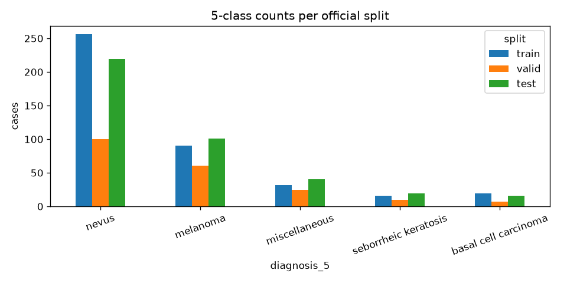
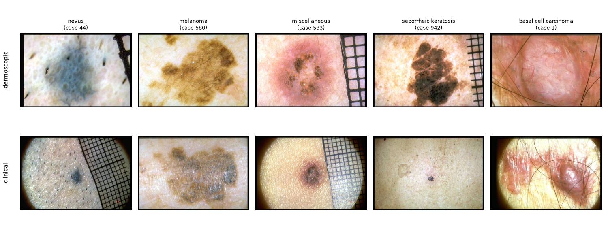

# Derm7pt data report

Generated by `src/data/data_report.py` from `data/processed/cases.csv`.

- Cases: **1011** (official split: train 413, valid 203, test 395)
- Cases with no real clinical image: **9** (the `clinic` file is a copy of the dermoscopic one). Rule: keep them, zero clinical input + missing flag.

## 1. Classes per split

| diagnosis_5 | train | valid | test | All |
|---|---|---|---|---|
| nevus | 256 | 100 | 219 | 575 |
| melanoma | 90 | 61 | 101 | 252 |
| miscellaneous | 32 | 25 | 40 | 97 |
| seborrheic keratosis | 16 | 10 | 19 | 45 |
| basal cell carcinoma | 19 | 7 | 16 | 42 |
| All | 413 | 203 | 395 | 1011 |

Train baseline: always predicting *nevus* scores 55.4% accuracy on test. This is why we report balanced accuracy / per-class metrics, not plain accuracy.

## 2. Sample images (train)

## 3. Metadata (allowed model inputs)

### elevation

| elevation | nevus | melanoma | miscellaneous | seborrheic keratosis | basal cell carcinoma |
|---|---|---|---|---|---|
| flat | 322 | 74 | 49 | 3 | 0 |
| nodular | 31 | 55 | 13 | 9 | 15 |
| palpable | 222 | 123 | 35 | 33 | 27 |

### location

| location | nevus | melanoma | miscellaneous | seborrheic keratosis | basal cell carcinoma |
|---|---|---|---|---|---|
| abdomen | 90 | 18 | 5 | 11 | 1 |
| acral | 52 | 3 | 7 | 0 | 0 |
| back | 177 | 68 | 6 | 12 | 18 |
| buttocks | 17 | 3 | 1 | 0 | 0 |
| chest | 57 | 31 | 5 | 6 | 1 |
| genital areas | 0 | 1 | 7 | 0 | 0 |
| head neck | 19 | 23 | 22 | 11 | 17 |
| lower limbs | 107 | 73 | 19 | 0 | 1 |
| upper limbs | 56 | 32 | 25 | 5 | 4 |

### sex

| sex | nevus | melanoma | miscellaneous | seborrheic keratosis | basal cell carcinoma |
|---|---|---|---|---|---|
| female | 288 | 136 | 57 | 17 | 24 |
| male | 287 | 116 | 40 | 28 | 18 |

## 4. The 7 concepts (training targets only; predicted from images at test time)

### pigment_network

| pigment_network | nevus | melanoma | miscellaneous | seborrheic keratosis | basal cell carcinoma |
|---|---|---|---|---|---|
| absent | 195 | 81 | 52 | 33 | 39 |
| atypical | 78 | 138 | 8 | 5 | 1 |
| typical | 302 | 33 | 37 | 7 | 2 |

### streaks

| streaks | nevus | melanoma | miscellaneous | seborrheic keratosis | basal cell carcinoma |
|---|---|---|---|---|---|
| absent | 400 | 94 | 79 | 41 | 39 |
| irregular | 85 | 152 | 8 | 3 | 3 |
| regular | 90 | 6 | 10 | 1 | 0 |

### pigmentation

| pigmentation | nevus | melanoma | miscellaneous | seborrheic keratosis | basal cell carcinoma |
|---|---|---|---|---|---|
| absent | 376 | 108 | 65 | 10 | 29 |
| diffuse irregular | 100 | 127 | 8 | 19 | 11 |
| diffuse regular | 77 | 2 | 21 | 15 | 0 |
| localized irregular | 20 | 14 | 3 | 1 | 2 |
| localized regular | 2 | 1 | 0 | 0 | 0 |

### regression_structures

| regression_structures | nevus | melanoma | miscellaneous | seborrheic keratosis | basal cell carcinoma |
|---|---|---|---|---|---|
| absent | 452 | 142 | 87 | 42 | 35 |
| blue areas | 73 | 35 | 2 | 2 | 4 |
| combinations | 32 | 60 | 4 | 1 | 2 |
| white areas | 18 | 15 | 4 | 0 | 1 |

### dots_and_globules

| dots_and_globules | nevus | melanoma | miscellaneous | seborrheic keratosis | basal cell carcinoma |
|---|---|---|---|---|---|
| absent | 113 | 21 | 54 | 22 | 19 |
| irregular | 171 | 221 | 23 | 11 | 22 |
| regular | 291 | 10 | 20 | 12 | 1 |

### blue_whitish_veil

| blue_whitish_veil | nevus | melanoma | miscellaneous | seborrheic keratosis | basal cell carcinoma |
|---|---|---|---|---|---|
| absent | 512 | 132 | 96 | 43 | 33 |
| present | 63 | 120 | 1 | 2 | 9 |

### vascular_structures

| vascular_structures | nevus | melanoma | miscellaneous | seborrheic keratosis | basal cell carcinoma |
|---|---|---|---|---|---|
| absent | 518 | 172 | 83 | 35 | 15 |
| arborizing | 3 | 2 | 2 | 1 | 23 |
| comma | 19 | 0 | 3 | 1 | 0 |
| dotted | 17 | 29 | 4 | 2 | 1 |
| hairpin | 1 | 4 | 2 | 6 | 2 |
| linear irregular | 1 | 17 | 0 | 0 | 0 |
| within regression | 16 | 28 | 1 | 0 | 1 |
| wreath | 0 | 0 | 2 | 0 | 0 |

## 5. Leakage preview (NOT model inputs)

One-rule check: for each column, map every value to its most common class in train, then score that rule on test with balanced accuracy (always-nevus = 20%). A column far above 20% carries class information; for the leaky columns that information comes from the doctor's decision, not the lesion. The full audit is research question 3.

| column | one-rule test balanced accuracy |
|---|---|
| management | 20.0% |
| level_of_diagnostic_difficulty | 20.0% |
| seven_point_score | 33.1% |
| elevation | 20.0% |
| location | 20.5% |
| sex | 20.0% |

**Caution:** the one-rule check underestimates leakage. A column can rule classes *out* without making a minority class the most common value. Example below: every melanoma and BCC was excised, and no 'clinical follow up' case is melanoma. Combined with images, this is a strong shortcut. RQ3 measures it properly by adding these columns to the fusion model.

### management vs class

| management | nevus | melanoma | miscellaneous | seborrheic keratosis | basal cell carcinoma |
|---|---|---|---|---|---|
| clinical follow up | 268 | 0 | 24 | 4 | 0 |
| excision | 278 | 252 | 23 | 10 | 42 |
| no further examination | 29 | 0 | 50 | 31 | 0 |

### seven_point_score: mean per class

| diagnosis_5 | mean | std |
|---|---|---|
| nevus | 1.42 | 1.59 |
| melanoma | 4.89 | 1.85 |
| miscellaneous | 0.8 | 1.32 |
| seborrheic keratosis | 1.22 | 1.28 |
| basal cell carcinoma | 1.6 | 1.42 |
