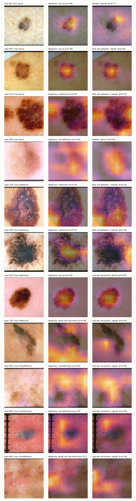
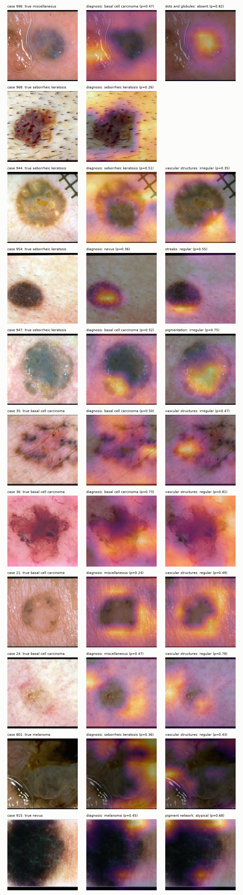

# Phase 4.2: Grad-CAM on the fine-tuned dermoscopic network

Heatmap of the last feature map (7x7, enlarged). Middle column: the network's predicted diagnosis. Right column: the concept SHAP ranked highest for the fusion prediction, at its predicted value. Correct/wrong = the dermoscopic network's own diagnosis head (not the fusion model).

## Shortcut check (all 395 test images)

Dark border = pixels with brightness < 0.12 connected to the image edge. If heat ignored the border, 'heat on dark' would be below the dark share; if the network used the border as a shortcut, it would be above.

| check | all test | correct | wrong |
|---|---|---|---|
| heat in outer 10% frame (uniform heat = 0.36) | 0.196 | 0.155 | 0.270 |
| images with dark border (>5% dark pixels): n=9 | 0.02 of images | 6 | 3 |
|   dark share of image (mean) | 0.113 | 0.070 | 0.201 |
|   heat on dark pixels (mean) | 0.084 | 0.042 | 0.168 |
|   share of images: heat on dark > dark share | 0.11 | 0.00 | 0.33 |

Most border-focused cases:

| case_num | true | pred | dark_area | heat_on_dark | heat_on_ring |
|---|---|---|---|---|---|
| 801 | melanoma | seborrheic keratosis | 0.16 | 0.28700000047683716 | 0.4959999918937683 |
| 915 | nevus | melanoma | 0.381 | 0.20399999618530273 | 0.4309999942779541 |
| 711 | melanoma | melanoma | 0.124 | 0.09300000220537186 | 0.4480000138282776 |
| 303 | nevus | seborrheic keratosis | 0.045 | 0.0820000022649765 | 0.5059999823570251 |
| 1011 | melanoma | seborrheic keratosis | 0.039 | 0.06499999761581421 | 0.4699999988079071 |

