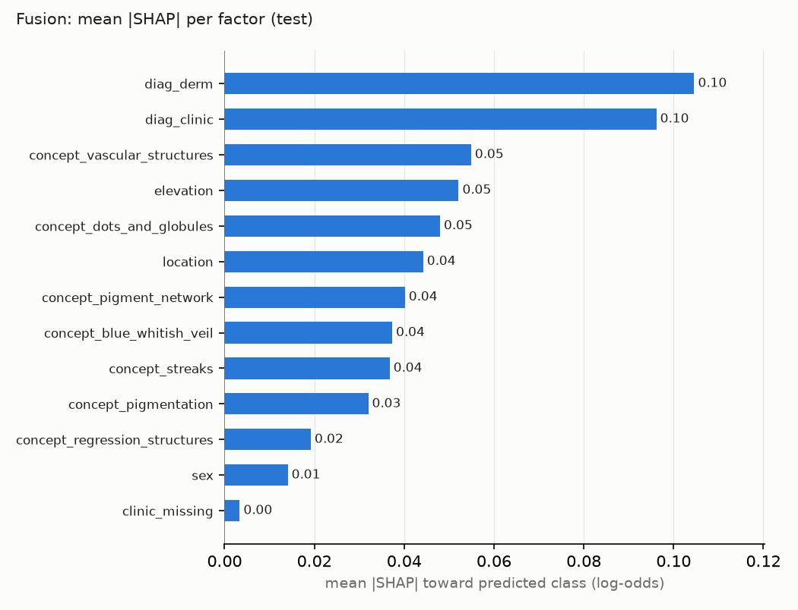
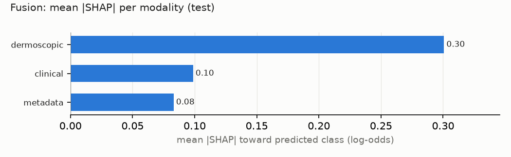
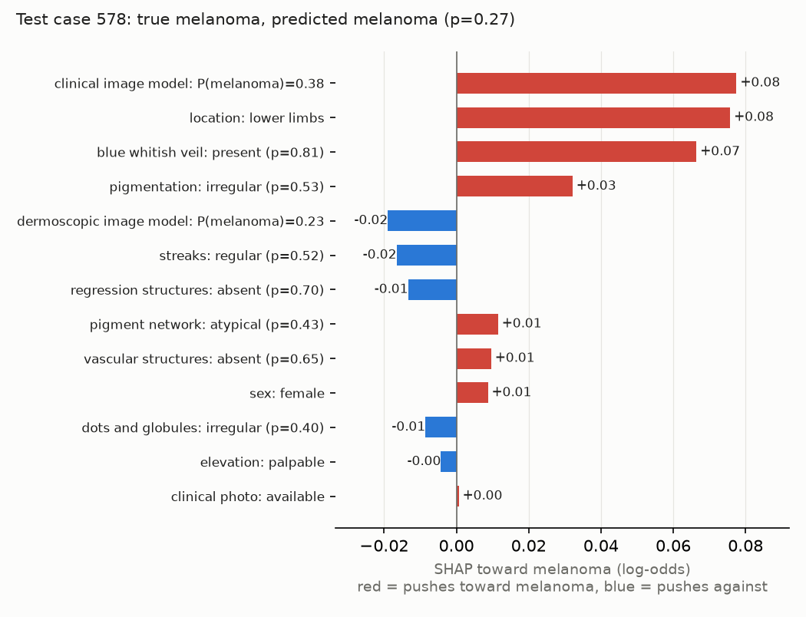

# Phase 4.1: SHAP explanations of the fusion model

Exact linear SHAP (shap.LinearExplainer, background = train rows), log-odds units, toward each case's PREDICTED class. Factor = sum of its columns. Test set (395 cases).

Checks: max |shap - hand formula| = 0.0e+00; additivity error = 5.6e-16.

## Factor importance

| factor | modality | mean_abs_shap | bal_acc_drop_if_occluded |
|---|---|---|---|
| diag_derm | dermoscopic | 0.105 | +0.072 |
| diag_clinic | clinical | 0.096 | +0.044 |
| concept_vascular_structures | dermoscopic | 0.055 | +0.021 |
| elevation | metadata | 0.052 | +0.007 |
| concept_dots_and_globules | dermoscopic | 0.048 | +0.003 |
| location | metadata | 0.044 | +0.016 |
| concept_pigment_network | dermoscopic | 0.040 | -0.002 |
| concept_blue_whitish_veil | dermoscopic | 0.037 | +0.008 |
| concept_streaks | dermoscopic | 0.037 | -0.002 |
| concept_pigmentation | dermoscopic | 0.032 | -0.006 |
| concept_regression_structures | dermoscopic | 0.019 | -0.002 |
| sex | metadata | 0.014 | +0.001 |
| clinic_missing | clinical | 0.003 | -0.005 |

Spearman rank correlation, mean |SHAP| vs balanced-accuracy drop when occluded (13 factors): rho = 0.82 (p = 0.001).

## Top 10 single columns

| column | mean_abs_shap |
|---|---|
| diag_clinic__miscellaneous | 0.035 |
| diag_derm__basal cell carcinoma | 0.034 |
| diag_clinic__basal cell carcinoma | 0.029 |
| diag_derm__nevus | 0.028 |
| diag_derm__miscellaneous | 0.025 |
| elevation=flat | 0.025 |
| concept_vascular_structures__REG | 0.024 |
| diag_clinic__nevus | 0.024 |
| concept_vascular_structures__ABS | 0.023 |
| concept_pigmentation__IR | 0.023 |

## RQ2: modality ranking, SHAP vs real removal drop (test balanced accuracy)

| modality | mean_abs_shap | drop_retrain | drop_occlude | rank_mean_abs_shap | rank_drop_retrain | rank_drop_occlude |
|---|---|---|---|---|---|---|
| dermoscopic | 0.301 | 0.093 | 0.175 | 1 | 1 | 1 |
| clinical | 0.099 | -0.024 | 0.044 | 2 | 3 | 2 |
| metadata | 0.083 | 0.026 | 0.011 | 3 | 2 | 3 |

## Faithfulness: deletion test

Occlude the top-k factors (by SHAP) vs k random factors (mean of 50 draws); drop in the probability of the predicted class, share of predictions that change, and share of cases where top-k hurt more than random.

| k | prob_drop_top | prob_drop_random | flip_rate_top | flip_rate_random | top_beats_random |
|---|---|---|---|---|---|
| 1 | 0.038 | 0.008 | 0.27 | 0.05 | 1.00 |
| 2 | 0.061 | 0.017 | 0.41 | 0.09 | 1.00 |
| 3 | 0.078 | 0.025 | 0.53 | 0.12 | 1.00 |
| 5 | 0.098 | 0.040 | 0.63 | 0.18 | 1.00 |

## Example explanation

